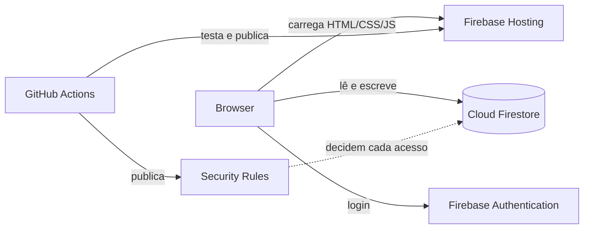
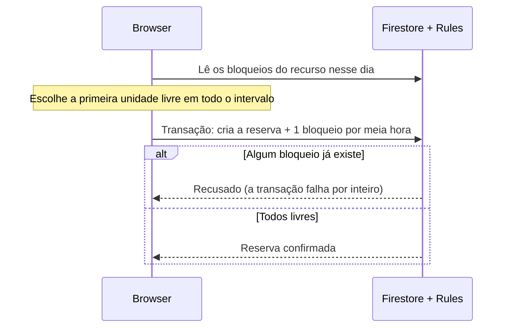
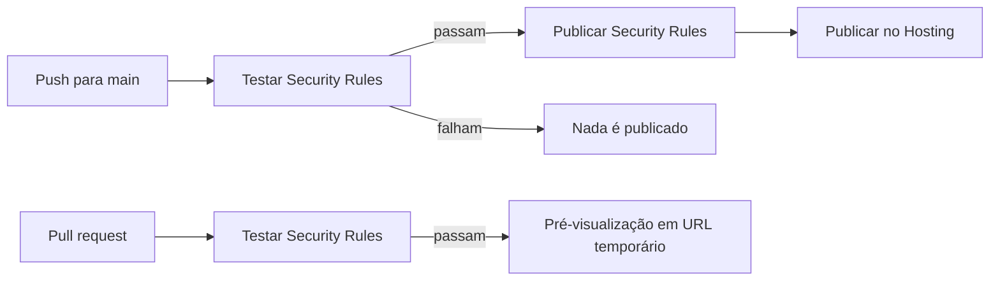

# CampusReserva

Aplicação web para reservar salas e equipamentos do ISLA Gaia. Projeto prático de Computação em Nuvem (Mestrado, 2026/27).

**Produção:** https://campusreservage.web.app · **Projeto Firebase:** `campusreservage` (plano Spark, gratuito)

---

## Arquitetura

Modelo **BaaS** (Backend as a Service) sobre Firebase. Não existe servidor próprio: toda a lógica corre no browser e a segurança é imposta pelas **Firestore Security Rules**.



| Componente | Função |
|---|---|
| Firebase Hosting | Serve a pasta `public/` |
| Firebase Authentication | Login por email e palavra-passe |
| Cloud Firestore | Base de dados documental (perfis, recursos, reservas, bloqueios) |
| Security Rules (`firestore.rules`) | Quem pode ler e escrever o quê; garantem a ausência de sobreposições |
| GitHub Actions | Testes das regras e deploy automático a cada push para `main` |

Front-end em HTML, CSS e JavaScript (módulos ES), com o SDK Firebase 10.4.0 importado por CDN.

---

## Estrutura do repositório

| Caminho | Conteúdo |
|---|---|
| `public/index.html`, `public/js/index.js` | Página de login |
| `public/dashboard.html`, `public/js/dashboard.js` | Área reservada: recursos, reservas, gestão |
| `public/js/firebase.js` | Configuração Firebase e ligação automática aos emuladores |
| `public/css/`, `public/assets/` | Estilos e logótipo |
| `firestore.rules` | Security Rules |
| `tests/firestore.rules.test.js` | Testes automáticos das regras |
| `.github/workflows/` | Pipelines de CI/CD |
| `firebase.json`, `.firebaserc` | Configuração do Hosting, do Firestore e dos emuladores |
| `Dockerfile`, `docker-compose.yaml` | Ambiente de desenvolvimento alternativo em contentor |
| `package.json` | Scripts e dependências de desenvolvimento |

---

## Perfis

| Perfil | Pode |
|---|---|
| **Utilizador** | Ver recursos ativos, reservar, ver e cancelar as suas reservas |
| **Gestor** | Tudo o que o utilizador faz, mais: criar, editar, ativar e desativar recursos; ver e cancelar qualquer reserva; promover e despromover outros utilizadores (nunca a si próprio) |

**Os perfis não são criados automaticamente.** Uma conta sem documento em `users` é tratada como utilizador. Para criar um perfil (em produção, na consola Firebase; localmente, na Emulator UI):

1. Em **Authentication**, copiar o **User UID** da conta.
2. Em **Firestore**, coleção `users`, criar um documento cujo **ID é o UID** (não basta ter um campo com o UID).
3. Campos: `uid`, `email`, `displayName`, `role` (`"utilizador"` ou `"gestor"`).

A partir daí, um gestor pode promover outros utilizadores na aplicação.

---

## Modelo de dados (Cloud Firestore)

Os nomes dos campos estão em inglês.

**`users/{uid}`**: `uid`, `email`, `displayName`, `role` (`utilizador` | `gestor`), `createdAt`, `updatedAt`

**`resources/{autoId}`**: `name`, `type` (`sala` | `equipamento`), `location`, `capacity`, `description`, `active`, `createdAt`, `updatedAt`
- Numa **sala**, `capacity` é o número de lugares (opcional).
- Num **equipamento**, `capacity` é o **número de unidades** (obrigatório, 1–1000); cada unidade é reservável em separado.
- Recursos não se apagam: desativam-se com `active: false`.

**`reservations/{autoId}`**: `userId`, `resourceId`, `resourceName`, `resourceType`, `date` (`AAAA-MM-DD`), `startTime`, `endTime` (`HH:MM`), `durationMinutes`, `unitNumber`, `slotId`, `slotIds`, `status` (`ativa` | `cancelada`), `createdAt`, `cancelledAt`
- Reservas não se apagam: cancelam-se.

**`reservationSlots/{id}`**: `reservationId`, `resourceId`, `date`, `startTime`, `unitNumber`
- Um documento de **bloqueio por cada meia hora** de cada reserva. Não contém dados pessoais, por isso qualquer utilizador autenticado o pode ler para ver a disponibilidade.
- ID determinístico:
  - sala: `{resourceId}_{date}_{HH:MM}`
  - equipamento: `{resourceId}_{date}_{HH:MM}_unit_{n}`

**Horários:** grelha de 30 minutos, início entre 08:00 e 21:30, fim até às 22:00, duração de 30 a 180 minutos.

---

## Reservas sem sobreposição



A exclusividade é imposta pelas **regras**, não pelo browser:

- Um bloqueio **nunca pode ser atualizado**. Escrever sobre um bloqueio existente conta como atualização, por isso é recusado, e a transação inteira falha.
- Uma reserva de N meias horas tem de ter **exatamente N bloqueios**, todos diferentes, dentro do intervalo e a apontar para ela (verificado com `getAfter()`).
- O nome e o tipo do recurso na reserva têm de coincidir com o documento do recurso.
- **Cancelar** muda o estado para `cancelada` e apaga todos os bloqueios **na mesma transação**; as regras recusam um cancelamento que deixe bloqueios para trás.

---

## Ambientes

| | Produção | Desenvolvimento local |
|---|---|---|
| URL da aplicação | https://campusreservage.web.app | http://localhost:5000 |
| Authentication e Firestore | Serviços reais da Google | Emuladores locais (Auth 9099, Firestore 8080) |
| Contas e dados | Reais | De teste, só no teu computador |
| Security Rules | Publicadas pelo pipeline | Lidas diretamente de `firestore.rules` |

A escolha é **automática** em `public/js/firebase.js`: se a aplicação estiver aberta em `localhost` ou `127.0.0.1`, liga-se aos emuladores; caso contrário, ao Firebase real. Não é preciso alterar nada antes de fazer commit.

Os dois ambientes são completamente separados: as contas de produção não existem no emulador e vice-versa.

---

## Desenvolvimento local

**Requisitos:** Node.js 24, Java 21 (necessário ao emulador do Firestore), npm.

```bash
npm install
npm run emuladores
```

| Endereço | O quê |
|---|---|
| http://localhost:5000 | Aplicação (Hosting emulado) |
| http://localhost:4000 | Emulator UI (contas, dados, pedidos) |

| Script | Faz |
|---|---|
| `npm run emuladores` | Arranca os emuladores; ao parar (Ctrl+C), guarda os dados em `dados-emulador/` |
| `npm run emuladores:continuar` | Arranca os emuladores e carrega os dados guardados |
| `npm run test:regras` | Corre os testes das Security Rules (ver abaixo) |

A pasta `dados-emulador/` está no `.gitignore`: os dados de teste de cada um não vão para o repositório.

**Primeira utilização:** os emuladores começam vazios. Criar uma conta na Emulator UI (Authentication → Add user) e, se for preciso um gestor, o perfil correspondente (ver [Perfis](#perfis)).

### Alternativa: Docker

O `Dockerfile` cria um ambiente com Node, Java e a Firebase CLI, e arranca os emuladores.

```bash
docker build -t campusreserva-emuladores .
docker compose up
```

Notas:
- O contentor corre como root, por isso os ficheiros `*.log` que cria na pasta do projeto ficam do root (ver [Resolução de problemas](#resolução-de-problemas)).
- Não correr os emuladores por Docker e por `npm run emuladores` ao mesmo tempo: as portas entram em conflito.
- Preferir os scripts npm para o dia a dia.

---

## Testes das Security Rules

```bash
npm run test:regras
```

Arranca um emulador temporário do Firestore com o projeto `demo-campusreserva` (o prefixo `demo-` garante que nunca se contacta o projeto real), corre os testes e desliga-o.

**58 testes em 3 grupos:**
- **Perfis:** criação, promoção, leitura de perfis alheios.
- **Recursos:** só o gestor cria e edita; validação de tipo e unidades; nada se apaga.
- **Reservas:** durações de 30 a 180 min, unidades de equipamento, sobreposição total e parcial, bloqueios em falta, repetidos ou forjados, datas e horas inválidas, nome falsificado, cancelamento pelo dono e pelo gestor.

Ferramentas: `@firebase/rules-unit-testing` e o test runner nativo do Node (`node:test`).

---

## CI/CD (GitHub Actions)



| Workflow | Quando | Faz |
|---|---|---|
| `firebase-hosting-merge.yml` | Push para `main` | Testes → publica `firestore.rules` → publica o Hosting |
| `firebase-hosting-pull-request.yml` | Pull request | Testes → publica uma pré-visualização (comentada no PR) |

As regras são publicadas **antes** do Hosting, para que uma versão nova da aplicação nunca corra contra regras antigas.

**Credenciais:**
- Secret do repositório: `FIREBASE_SERVICE_ACCOUNT_CAMPUSRESERVAGE` (chave da service account `github-action-…@campusreservage.iam.gserviceaccount.com`).
- Papéis IAM necessários dessa conta: Administrador do Firebase Hosting, **Administrador de regras do Firebase** e Consumidor do Service Usage.

---

## Configuração relevante

| Ficheiro | O que importa |
|---|---|
| `firebase.json` | Hosting serve `public/` e redireciona tudo para `index.html`; regras em `firestore.rules`; portas dos emuladores (Auth 9099, Firestore 8080, Hosting 5000, UI 4000) em `0.0.0.0`; `singleProjectMode` |
| `.firebaserc` | Projeto por omissão: `campusreservage` |
| `public/js/firebase.js` | Configuração web do Firebase (pública por natureza) e deteção dos emuladores |
| `package.json` | Scripts de emuladores e testes; dependências de desenvolvimento (`firebase-tools`, `@firebase/rules-unit-testing`, `firebase`) |
| `.gitignore` | `node_modules/`, `.firebase/`, `*.log`, `dados-emulador/` |

---

## Custo zero (plano Spark)

Regras do projeto: nunca fazer upgrade para o plano Blaze, nem associar uma conta de faturação. Cloud Functions e Cloud Storage não estão disponíveis.

| Serviço | Limite gratuito |
|---|---|
| Hosting | 10 GB armazenados; 360 MB/dia de transferência |
| Firestore | 1 GiB; 50 000 leituras, 20 000 escritas e 20 000 eliminações por dia |
| Authentication | 50 000 utilizadores ativos por mês |

Desenvolvimento e testes correm nos emuladores e não consomem quota.

---

## Resolução de problemas

| Sintoma | Causa | Solução |
|---|---|---|
| `Port 8080 is not open … port taken` | Ficou um emulador a correr | `pgrep -a java` e depois `kill <PID>`; ou `docker compose down` |
| `An unexpected error has occurred` e, no `firebase-debug.log`, `EACCES … firestore-debug.log` | O log foi criado pelo Docker como root | `sudo rm firestore-debug.log` (e outros `*.log` do root: `find . -user root -not -path "./node_modules/*"`) |
| A conta real não entra em `localhost:5000` | Esperado: o emulador não conhece as contas de produção | Criar uma conta na Emulator UI |
| A conta aparece como "Utilizador" em vez de "Gestor" | O ID do documento em `users` não é o UID | Criar um documento novo com o ID igual ao UID (os IDs não se podem mudar) |
| "Bloqueado pelas regras do Firestore" em produção | As regras publicadas estão desatualizadas | Confirmar no separador Actions que o job "Publicar Security Rules" passou |

---

## Limitações conhecidas

- Grelha fixa de 30 minutos, das 08:00 às 22:00, com reservas até 3 horas.
- Os perfis são criados manualmente.
- `resourceName` é copiado para a reserva: renomear um recurso não altera as reservas antigas.
- Desativar um recurso não cancela as reservas futuras já feitas.
- As datas passadas são bloqueadas na interface, mas não nas regras.
- Dependência do fornecedor (Firebase): as regras, a autenticação e a base de dados não são portáveis diretamente para outra plataforma.

---

## Equipa

Diogo Pereira · Rúben Afonso · Filipe Cardoso
